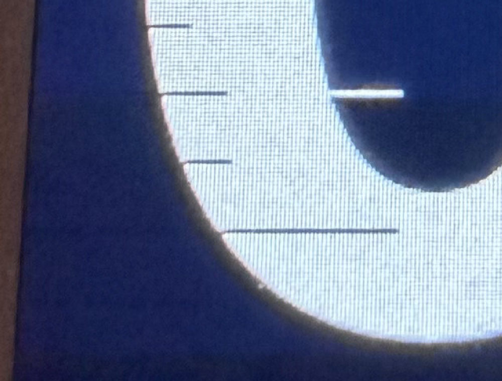

# JC8048W550 联网时钟 + 天气（**屏幕设置向导版**）

给 **JC8048W550 / ESP32-S3-WROOM-1 N16R8 + 5 寸 800×480 IPS 电容屏** 写的
Arduino + LVGL 网络时钟。这是 `ClockWeather` 的**第二个版本**，区别：

| | ClockWeather | **ClockWeatherSetup（本版本）** |
|---|---|---|
| WiFi / 城市 | 写死在 `config.h`，改一次要重烧 | **在屏幕上设置**，存 Flash，以后自动用 |
| 平时显示 | 一直是大钟 + 天气看板 | **满屏大时钟 + 最下面一条当前详细天气**；点一下才看完整看板，5 分钟自动回去 |
| 设置向导 | 无 | 扫 WiFi / 输密码 / 选省市的三个页面 |
| 适用 | 自己用，改代码方便 | **给别人/送人**，不用教对方装 Arduino |

```
     平时（满屏大时钟 + 底部当前天气）          点一下屏幕 ↓          看板（5 分钟后自动回去）
┌──────────────────────────────┐      ┌──────────────────────────────────────────────┐
│                     ● 已联网  │      │ 宁波市 9月20日 周六 ●已联网 [刷新天气][大时钟][设置]│
│           08:42              │      ├──────────────────────┬───────────────────────┤
│                              │  →   │                      │  ☀☁   23.4°           │
│        9月20日 周六           │      │       08:42          │        多云            │
│ ┌──────────────────────────┐ │      │   ━━━━━━━━  37       │ 体感/湿度/风速/气压     │
│ │☁ 23.4° 多云 │体感 25.1°C  │ │      ├──────────────────────┴───────────────────────┤
│ │  湿度 62% 风速 3.2m/s 气压│ │      │ ┌─今天─┐ ┌─明天─┐ ┌─后天─┐                  │
│ └──────────────────────────┘ │      └──────────────────────────────────────────────┘
└──────────────────────────────┘
```

完整效果图见同目录 `preview.svg`（用浏览器打开，五屏并排）。

---

## 一、它和 ClockWeather 的取舍

* **好处**：WiFi 密码和地区不用再改代码。第一次开机走一遍屏幕向导，
  配置存进 ESP32 的 NVS（Flash），掉电不丢；换 WiFi、换城市随时在屏幕上改。
* **代价**：多了设置向导（软键盘、省市数据、大时钟字库），
  Flash 占用比 ClockWeather 大一些（见第八节实测），LVGL 内存从 48KB 提到 80KB。
* 两个工程**互相独立**，字体/驱动各自带一份，可以只烧其中一个。

---

## 二、硬件信息（和 ClockWeather 相同，已核对）

这块板是 **ESP32-S3-WROOM-1 N16R8**（16MB Flash + 8MB OPI PSRAM），
屏幕是 **ST7262 驱动、RGB565 并口、800×480**，触摸是 **GT911 电容触摸（I2C）**。

| 信号 | GPIO | 信号 | GPIO |
|---|---|---|---|
| DE | 40 | R0 / R1 / R2 / R3 / R4 | 45 / 48 / 47 / 21 / 14 |
| VSYNC | 41 | G0 / G1 / G2 / G3 / G4 / G5 | 5 / 6 / 7 / 15 / 16 / 4 |
| HSYNC | 39 | B0 / B1 / B2 / B3 / B4 | 8 / 3 / 46 / 9 / 1 |
| **PCLK** | **42** | 背光 BL | 2 |
| 触摸 SDA | 19 | 触摸 SCL | 20 |
| 触摸 RST | 38 | 触摸 INT | 18 |

> ⚠️ **PCLK 是 GPIO42，不是 GPIO12。** GPIO12/13/11/10 是 TF 卡总线。
> GT911 的 I2C 地址由复位时 INT 电平决定（0x5D 或 0x14），程序会自动探测。

---

## 三、装库（版本很关键）

Arduino IDE → **工具 → 管理库**：

| 库 | 作者 | 版本 |
|---|---|---|
| **lvgl** | LVGL | **必须 8.4.0**（不要 9.x） |
| ~~GFX Library for Arduino~~ | Moon On Our Nation | **v2.3 起已不需要**（display.cpp 直接调 ESP-IDF 的 esp_lcd_new_rgb_panel） |

### ⚠️ lv_conf.h 要放对位置

把本工程里的 `lv_conf.h` 复制到 **Arduino 的 libraries 目录下**，
和 `lvgl` 文件夹**同级**：

```
Arduino/libraries/
    ├── lvgl/
    ├── lv_conf.h          ← 本工程这份（比 ClockWeather 多了软键盘/输入框）
    ├── GFX_Library_for_Arduino/
    └── ...
```

> 本版本的 `lv_conf.h` **打开**了 `LV_USE_KEYBOARD / LV_USE_TEXTAREA /
> LV_USE_BTNMATRIX`，并把默认字体改成 24px。用 ClockWeather 那份会编译失败。

### ✅ 不再需要给 Arduino_GFX 打补丁（v2.3 起）

> **v2.3 起本工程完全不依赖 Arduino_GFX**：`display.cpp` 直接调
> `esp_lcd_new_rgb_panel()` 建面板（为了能自己填搬运缓冲，见第九节），
> 面板句柄是我们自己的，`pclk` / `restart` 命令也不再需要 `_panel_handle`。
> 编译时不用再改库文件，`tools/patch_gfx.ps1` 保留只为兼容老版本。

下面是 v2.2 及更早版本的做法（保留作历史记录）：
`display_set_pclk()` 当时要拿 Arduino_GFX 的 `_panel_handle`，得把它从 private
放开，不打补丁会报：

```
error: 'esp_lcd_panel_t* Arduino_ESP32RGBPanel::_panel_handle' is private within this context
  .../Arduino_ESP32RGBPanel.h:146:26: note: declared private here
```

**改法（手动，30 秒）**：用记事本 / VS Code 打开

```
C:\Users\<你的用户名>\Documents\Arduino\libraries\GFX_Library_for_Arduino\src\databus\Arduino_ESP32RGBPanel.h
```

搜索 `_panel_handle`（在这份库的**第 146 行**），往上找到最近的一个
**`private:`**（在**第 125 行**，紧接着就是 `int32_t _speed;`），
把它改成：

```c
public:
```

保存，回 Arduino IDE 重新点「上传」。（只动这一处，库的其它部分不受影响。）

**一键脚本（Windows / PowerShell）**：仓库里带了 `tools/patch_gfx.ps1`，
会自动找到库文件、备份 `.bak` 并改好这一行：

```powershell
cd <本仓库>\tools
powershell -ExecutionPolicy Bypass -File .\patch_gfx.ps1
```

找不到库时把路径当参数传进去：

```powershell
powershell -ExecutionPolicy Bypass -File .\patch_gfx.ps1 "C:\Users\<你的用户名>\Documents\Arduino\libraries\GFX_Library_for_Arduino\src\databus\Arduino_ESP32RGBPanel.h"
```

> 装了 Node 也可以用 `node tools/patch_gfx.js [头文件路径]`，效果一样（两个脚本都会自动
> 搜索 `.build`、`Documents\Arduino\libraries`、`~/Arduino/libraries` 等位置）。
>
> **不想改库**：把 `diag.cpp` 里的 `pclk` 命令去掉（或者让 `display_set_pclk()`
> 直接 `return false`），也能编译通过；代价是没法在现场试像素时钟，
> 只能改 `board_pins.h` 的 `LCD_PREFER_SPEED` 重新烧录。
>
> ⚠️ 补丁打在库文件上，**升级 / 重装 GFX 库后要重新打一次**。

---

## 四、Arduino IDE 开发板设置

开发板选 **ESP32S3 Dev Module**：

| 项目 | 值 |
|---|---|
| PSRAM | **OPI PSRAM**（★ 必须，750KB 帧缓冲放这里） |
| Flash Size | **16MB (128Mb)** |
| Flash Mode | **QIO 80MHz** |
| Partition Scheme | **16M Flash (3MB APP/9.9MB FATFS)** |
| USB CDC On Boot | **Disabled**（★ GPIO19/20 是触摸 I2C） |
| CPU Frequency | 240MHz (WiFi) |
| Upload Speed | 921600（失败就降 460800） |

> 用 **UART / CH340 那个 Type-C 口**烧录和看日志，串口波特率 115200。

---

## 五、第一次开机：屏幕上的设置向导

出厂 `config.h` 里 WiFi 和城市都是空的，所以第一次开机会直接进向导：

### ① 连接 WiFi

```
┌──────────────────────────────────────────────────────────────┐
│ 连接 WiFi                             [地区] [重新扫描]        │
│ 找到 6 个网络，点击即可连接                                   │
│  ▂▄▆█ 加密  MyHome-2.4G                            已保存  > │
│  ▂▄▆  加密  ChinaNet-8xKz                                 > │
│  ...                                                         │
│  +  手动输入网络名（隐藏的 WiFi）                             │
└──────────────────────────────────────────────────────────────┘
```

* 扫描是**异步**的，界面不会卡；同名热点只保留信号最强的那个，按信号排序。
* 「已保存」= 当前正在用的那个。点任意一行去输密码。
* 隐藏网络点最后一行手动输名字。

### ② 输入密码

LVGL 软键盘输入，`显示 / 隐藏` 切换密码可见性，右上角 `连接`。
密码短于 8 位会提示但仍然尝试；连不上会红字给出原因，可以直接重试。
**开放网络**会自动禁用密码框，直接点连接即可。

### ③ 选择地区

左边一列省份、右边一列城市，点省份右边就换成它的城市（默认选中第一个）。
全国 **34 个省级行政区 / 389 个城市**，坐标来自阿里 DataV.GeoAtlas 的行政中心点。
选完点右上角 `完成`，就进入大时钟。

> 地区数据在 `region_data.cpp`（自动生成，不要手改）。
> 想更新：`cd tools && node gen_regions.js`。

### ④ 关于屏幕亮度 —— 本板不支持调光

**结论**：这块 JC8048W550 的背光 **GPIO2 是「使能型」，调不了光**。实板逐档测的：

| 设置 | 结果 |
|---|---|
| 100% | 正常亮度 |
| 80% / 60% / 40% | **全黑（一点不亮，不是「变暗」）** |
| 10~25% | 全黑 |

说明 GPIO2 多半接在背光升压/驱动芯片的 **EN 脚**上，20kHz 的方波它跟不上
（软启动来不及），只有一直拉高才工作 —— 这不是软件能绕过去的。

所以这一版**把亮度调节整个删掉了**（向导里没有「亮度」页，固件里也不含相关
代码）：`display_init()` 里把 GPIO2 拉满，**屏幕永远是最亮的**，也就不可能被
谁调黑。串口里那几个救急命令（`bright 100` 之类）同样没用了，一起删掉。

> 还想挑战调光的话：方向是**降 PWM 频率**（频率越低，驱动芯片越有时间跟着
> 通断，但可能看到轻微闪烁）。把 `display.cpp` 里的 `BL_LEDC_FREQ` 从
> 20000 改成 500~2000 试。

> 想彻底回到出厂：`工具 → Erase All Flash Before Sketch Upload` 改成
> `Enabled` 再烧一次（WiFi、地区全清，重新走向导）。

### 以后想改

看板上点 **`设置`** → 回到 WiFi 列表（可重新扫描、换网络）；
列表页右上角的 **`地区`** 直接跳到地区页只改城市。

---

## 六、平时怎么用

| 操作 | 结果 |
|---|---|
| 平时 | **满屏大时钟**（290px 粗体）+ **40px 日期**，**最下面一条显示当前详细天气**；这一页不放按钮，保持干净 |
| 大时钟右上角 | 联网状态圆点 + 文字；**天气拉取失败的原因也显示在这里** |
| **点一下屏幕** | 切到「时间 + 天气」看板，同时开始 5 分钟倒计时 |
| 看板左上 | 城市 · 日期 |
| 看板右上 `刷新天气` | 立刻重试拉一次天气（不必干等 15 分钟的自动刷新）；拉取中显示 `刷新中…` |
| 看板放 5 分钟没操作 | 自动回到满屏大时钟 |
| 看板点 `大时钟` | 立刻回到满屏大时钟 |
| 看板点 `设置` | 进设置向导 |

> **顶栏文字宽度（都是实测出来的，不是估的）**
>
> * 城市日期写成 `宁波市 9月20日 周六` —— 用「周X」不用「星期X」，城市和日期
>   之间也只留一个空格。因为 `font_cjk_22` 里「·」是全角 22px：
>   `宁波市 · 9月20日 周六` 要 **227px**，`宁波市 · 12月28日 周六`（双位月日）
>   更要 **240px**；去掉「·」后分别只要 200 / 213px，220px 的框就都放得下了。
> * 城市日期和状态文字都**锁死一行高**（`lv_obj_set_size(..., lv_font_get_line_height())`）。
>   这一步很关键：LVGL 的 `LONG_DOT` 只在高度被限死时才会打「…」，
>   高度自适应的话它直接换行 —— 之前「周日」掉到第二行就是这个原因。
>   城市名太长（比如「乌鲁木齐市」）现在是打点，不再折行。
> * 状态/报错文字：大时钟页 **600px**（能显示完整原因），看板顶栏 **252px**
>   （三个按钮占地方，长句打点；想看全就看大时钟页，或者看串口）。

大时钟页最下面那条天气是**实时数据**，每次拉到天气就同步更新：

```
┌──────────────────────────────────────────────────────────────────────┐
│  ☁  23.4°  多云  │  体感 25.1°C    湿度 62%    风速 3.2m/s   气压 1013hPa │
└──────────────────────────────────────────────────────────────────────┘
```

* 还没拿到天气时（刚开机 / 断网）整条隐藏，不会挂着一排 `--`。
* 点这条天气也能切到看板（它不吃点击）。
* 5 分钟这个值在 `config.h` 的 `IDLE_RETURN_MIN` 里改。

### 看板下面那三张卡（今天 / 明天 / 后天）

```
┌─ 今天 ───────────── ☀ ┐
│  26° / 18°            │   ← 白字最高温 / 灰字最低温
│  ▓▓░░░░░░░░░░░░░░  8% │   ← 降水概率条 + 精确值
└───────────────────────┘
```

那条横条是**降水概率条**（`weather.days[i].pop`，来自 Open-Meteo 的
`precipitation_probability_max`）：

* **轨道是固定的 0~100% 刻度**，三张卡刻度一样，所以能横着比 —— 谁长谁更容易下雨。
* **长度 = 概率**，右边再用字写一遍精确值（概率条只能看个大概，数字才算准）。
* **颜色分三档**：`<25%` 灰蓝（基本没雨）、`25~60%` 浅蓝、`>60%` 亮蓝。
* 概率不是 0 但很小时也会留 6px，不至于看起来像没数据。
* 接口哪天没给这个字段，就画成 `--`（天数、温度照常显示，不受影响）。

> 想要回「温度区间条」（条子长度=当日温差、位置=三天里的冷暖位置）也可以，
> 把 `ui.cpp` 里那段概率条逻辑换回 `span_min/span_max` 那套算法就行，
> 改动只在 `ui.cpp` 的预报循环里。

---

## 七、config.h（可以不填）

```cpp
#define WIFI_SSID     ""     // 留空 = 用屏幕向导填
#define WIFI_PASSWORD ""
#define CITY_NAME     ""     // 留空 = 用屏幕向导选
#define CITY_LAT      0.0f
#define CITY_LON      0.0f
#define TIMEZONE      "CST-8"
#define IDLE_RETURN_MIN   5  // 看板多久自动回大时钟
```

* **全部留空**（推荐）：第一次开机进向导，配置存 Flash。
* **想跳过向导**：把 WiFi / 城市和经纬度填上，对应步骤就不出现
  （适合一次烧一批送人的成品）。
* 向导保存的值**优先于** `config.h`。

### 怎么恢复出厂 / 重新进向导

* 串口里调一次 `settings_clear_all()`（在 `ui.cpp` 里临时加一行即可），或者
* 用 Arduino IDE 的 **工具 → Erase All Flash Before Sketch Upload → Enabled**
  重新烧一次，NVS 会被一起清掉。

---

## 八、文件结构

```
ClockWeatherSetup/
├── ClockWeatherSetup.ino  主程序：初始化 + 主循环状态机
├── config.h               ★ 出厂默认值（可留空），第一次开机走向导
├── board_pins.h           板级引脚定义（含 PCLK=42、搬运缓冲行数、DMA 复位策略）
├── display.h/.cpp         ST7262 RGB 屏驱动（直接用 IDF，不依赖 Arduino_GFX）+ 自填搬运缓冲 + 统计
├── diag.h/.cpp            ★ 串口诊断命令（help / bench / stats / pclk / bounce / restart）
├── touch_gt911.h/.cpp     GT911 电容触摸驱动（自己实现，不依赖第三方库）
├── net_time.h/.cpp        WiFi 连接 / 扫描 + NTP 授时（全非阻塞）
├── settings.h/.cpp        ★ WiFi + 地区 的 Flash 存储（NVS）+ 公共小工具
├── setup_ui.h/.cpp        ★ 设置向导三个页面（WiFi / 密码 / 地区）
├── region_data.h/.cpp     ★ 全国省市 + 坐标（.cpp 由脚本生成）
├── ui.h/.cpp              ★ 两张主屏：满屏大时钟 / 时间+天气看板
├── weather.h/.cpp         Open-Meteo 天气（坐标来自 settings，不再地理编码）
├── weather_icon.h/.cpp    程序化绘制的天气图标（不用图片）
├── lv_conf.h              → 要复制到 Arduino/libraries/ 下（见第三节）
└── font_*.c               自造字库（见下表）
```

| 字库 | 字号 | 用途 | 文件大小 |
|---|---|---|---|
| `font_clock_290.c` | 290px 粗体 | **满屏大时钟** `0-9 : -` | 168 KB |
| `font_clock_193.c` | 193px 粗体 | 看板时钟 | 96 KB |
| `font_digits_44.c` | 44px | 温度 / 秒数 | 24 KB |
| `font_digits_32.c` | 32px | 预报温度 | 16 KB |
| `font_cjk_22.c` | 22px | 中文正文（3906 字：GB2312 一级 + 地名补充） | 4.2 MB |
| `font_cjk_28.c` | 28px | 设置向导（293 字，按需裁剪） | 308 KB |
| `font_cjk_32.c` | 32px | 天气描述（28 字） | 46 KB |
| `font_cjk_40.c` | 40px | 大时钟页下面的日期（39 字：0-9 月日周年星期一二三四五六 正在同步时间…） | 38 KB |

> **满屏大时钟的字号是算出来的，不是拍脑袋**：
> 粗体数字 advance ≈ 0.59 × 字号，冒号 ≈ 0.325 × 字号，
> 所以 `"HH:MM" 宽度 = 2.685 × 字号`。
> `2.685 × 290 ≈ 779px < 800px`，再大就超出屏幕 —— 290 就是上限。
> （生成脚本：`tools/gen_fonts.sh`，见第十节。）

---

## 九、常见问题

### 扫描不到任何 WiFi
1. 确认是 **2.4GHz**：ESP32 硬件不支持 5GHz，只开 5G 的路由器扫不到。
2. 路由器是否隐藏了 SSID —— 隐藏网络请用列表最后一行手动输入。
3. 点右上角「重新扫描」再试。

### 密码没错却连不上
* 密码**区分大小写**，注意软键盘的大小写状态（⇧）。
* 看串口日志：向导会打印 `[向导] 连接失败：…（SSID）`。
* 企业级认证（WPA2-Enterprise）和网页认证（酒店/校园）不支持。

### ★ 能扫描到 WiFi（列表出来了），但点屏幕没反应

**先别改代码**，看屏幕上**顶栏那一行小字**（默认开着，`config.h` 的
`UI_SHOW_TOUCH_DEBUG`）：

```
触摸 0x5D · 12次          ← ①GT911 地址  ②累计按下次数
坐标 412, 233             ← ③最近一次按下的屏幕坐标
```

（如果显示的是 `触摸: 未找到 GT911`，直接看表格第一行。）

对着这张表就能定位：

| 顶栏显示 | 说明 | 怎么办 |
|---|---|---|
| `触摸: 未找到 GT911` | 触摸芯片没初始化成功 | ★ 多半是 **USB CDC On Boot 选成了 Enabled** —— USB 外设占用了 GPIO19/20，而这两个脚正是触摸的 I2C。改成 **Disabled** 重新上传。再检查触摸排线 |
| 地址正常，但怎么点「按下次数」都不涨 | 按下事件没进到驱动 | 同上：CDC 设置 / 排线 / 触摸 INT 虚焊 |
| 次数在涨，但坐标和手指位置对不上 | 坐标映射不对 | 看是左右反、上下反还是 XY 换了，改 `board_pins.h` 底部 `TOUCH_SWAP_XY` / `TOUCH_MIRROR_X` / `TOUCH_MIRROR_Y`（0/1 互换）后重新上传 |
| 次数在涨、坐标也对，但点列表还是没反应 | 事件处理的问题 | 把串口日志（115200）发出来，并告诉我那一行坐标显示什么 |

> **坐标永远卡在最右下角 `799, 479`？** 那是触摸点寄存器基准写错一位的老 bug
> （`0x8150` 应为 `0x814F`，详见第十一节），**已经修好了**。
> 更新到这版 `touch_gt911.cpp` 就不会再出现。

另外：**按住列表任意一行时整行会变蓝**（按下反馈）。点下去完全不变蓝，
就说明按下事件没送到这一行，可以立即排除「点击处理写错了」。

串口（115200）也会打印每一次触摸，方便对照：

```
[触摸] GT911 地址 0x5D，产品 ID: 9110
[触摸] 芯片配置分辨率 800x480
[触摸] 按下 (412, 233)
[触摸] 抬起 (412, 233)
```

> 调好之后把 `config.h` 里 `UI_SHOW_TOUCH_DEBUG` 改成 `0`，顶栏那行就消失了。

### 天气拉取失败（大时钟右上角显示 `天气连不上：…`）

拉取现在跑在**后台任务**里，所以失败了**不会卡住界面**，而且会在三个地方告诉你原因：

* **大时钟右上角**（红色）：一句话原因，例如 `天气连不上：connection refused`
* **看板右上角**：同一句话
* **串口 115200**：完整诊断

```
[天气] api.open-meteo.com -> 104.18.x.x   空闲堆 128000  最大连续堆 40960
[天气] HTTPS 失败（TLS connection refused），改用明文 HTTP 重试…
[天气] 明文 HTTP 成功（说明 443/TLS 那条路不通）
[天气] 拿到 1523 字节  空闲堆 128000  最大连续堆 40960
```

每次拉取自动重试 **3 次**（后台重试不影响界面）；失败后 1 分钟再试一轮。
也可以点**看板右上角的 `刷新天气`** 立刻重试，不用干等。

### ★ 天气默认走明文 HTTP（不走 TLS）—— 实测量出来的结论

实板日志（`[心跳]` 那行）量出来的：

```
[心跳] 空闲堆 49432  最大连续堆 25588  LVGL 已用 57996/114688 ...
[网络] 开始扫描附近的 WiFi…
[天气] api.open-meteo.com -> 188.40.99.226  空闲堆 32344  最大连续堆 8180
[天气] HTTP -1 (connection refused)
```

* 界面跑起来后**最大连续堆只有 ~25KB**；扫描 WiFi 时掉到 **8KB**
* TLS 握手要一次性拿到 **16KB 以上连续内存** → **永远握不上**，只报 `HTTP -1`
* LVGL 那边很富裕（58KB/112KB，碎片 2%）→ **不是 LVGL 的问题**

所以 `weather_fetch()` 默认**直接走明文 HTTP**（`http://` 同一域名、80 端口），
完全不碰 mbedTLS：

* 只要几 KB 内存，8KB 连续块也够用；
* 国内网络对 80 端口通常比 443 宽松；
* 天气数据不敏感，没有隐私问题。

想改回 TLS 优先：`config.h` 的 `WEATHER_TRY_TLS_FIRST` 改成 `1`
（连续内存 < 20KB 时会自动跳过 TLS 直接走明文）。

> 附带好处：默认走明文时 `WiFiClientSecure` 那条分支成了死代码，
> 链接器把 mbedTLS 整块丢掉 —— **Flash 少 89KB**（2.03MB → 1.95MB）。

另外**扫描 WiFi 期间不再拉天气**了：扫描时 WiFi 会吃掉一大块内存（就是上面那
8KB 的来源），这时候去拉基本注定失败，等扫完再拉。

**对着 `[天气]` 那几行看：**

| 日志 | 含义 | 怎么办 |
|---|---|---|
| `DNS 解析失败` | 域名解析不出 IP | 路由器 DNS 问题；或在 `config.h` 里把 `WEATHER_HOST` 换成能解析的镜像 |
| 出现 `HTTPS 失败…改用明文 HTTP 重试`，然后 `明文 HTTP 成功` | 443/TLS 不通，80 通 | **能正常显示天气，不用管**；想彻底查就换个网络/路由器试试 |
| `HTTPS 失败` **并且** `HTTP 也失败`，且**最大连续堆很小**（< 20KB） | 内存太紧，连明文都快没堆用了 | 把 `display.cpp` 的 `LCD_DRAW_BUF_LINES` 从 24 调到 16，或把 `lv_conf.h` 的 `LV_MEM_SIZE` 降到 96KB |
| 两条都失败、最大连续堆也正常 | 这个域名在你那边就是连不通 | 换 `WEATHER_HOST`（见 `config.h` 说明），或换个网络试（手机热点最快能验证） |
| `HTTP 4xx / 5xx` | 接口返回错误 | 经纬度不对，或接口临时故障 |
| 有 DNS 那行、但一直没有结果 | 卡在连接 | 同上面第二/三条 |

> `WEATHER_HOST` 可以换成任何返回结构与 Open-Meteo 一致的地址（自建反代也行），
> 解析代码不用动。

### ★ 大时钟页面点屏幕没反应 / 时钟像卡住了

**现象**：设置向导里点着都正常；配置完切到满屏大时钟之后，点屏幕不切看板，
时间也像停住不动。

**原因（已修）**：天气是**在主循环里同步拉**的。`weather_fetch()` 里的 DNS 和
HTTPS 全是阻塞调用，网络慢或不通时一次能卡十几秒，重试三次就是大半分钟 ——
这段时间主循环停转，LVGL 不刷新、触摸不响应。

而**设置向导开着时本来就跳过天气**，所以向导很跟手；一旦配置完切到大时钟，
天气开始拉，界面就卡住了。这个坑在 ClockWeather（只读看板）里看不出来，
因为那时没有任何可点的东西。

**修法**：天气改成**后台 FreeRTOS 任务**拉（`ClockWeatherSetup.ino`），
主循环只负责启动任务和取结果，LVGL 只在主循环里被调用。
拉取期间界面照常刷新、照常响应触摸。

串口上这样能看出来：

```
[天气] 拉取失败: 天气接口连不上（HTTP -1）     ← 后台在重试，界面不受影响
[界面] 大时钟被点 -> 切看板                    ← 点一下就会打这行
[触摸] 按下 (412, 233)                         ← 触摸驱动收到按下
```

排查顺序：

1. 点一下大时钟，串口有没有 `[界面] 大时钟被点 -> 切看板`？
   * 有 → 触摸和点击都正常，问题只在显示（看下一条「画面闪」）。
   * 没有，但有 `[触摸] 按下 (x, y)` → 点击事件的问题，把日志发我。
   * 连 `[触摸] 按下` 都没有 → 回到上面「点屏幕没反应」那条排查触摸。
2. 时间不动就说明主循环被卡住了。新版已经不会再卡；万一还卡，
   把串口日志发我（重点看是不是一直停在 `[天气]` 相关的输出上）。

### 操作几下之后回大时钟会卡死

**原因（已修）**：LVGL 的内存池（`lv_conf.h` 的 `LV_MEM_SIZE`）原来只有 80KB，
而这一版把**两张主屏 + 设置向导三页 + WiFi 列表 + 软键盘 + 34 个省 / 一列城市**
全都塞在这个池子里。来回操作几次池子就满了 —— `lv_obj_create()` 拿不到内存会返回
NULL，接着就是控件画不出来、跑飞或直接卡死。

**修法**：

| 改动 | 省下 |
|---|---|
| `LV_MEM_SIZE` 80KB → **112KB** | 直接给池子加 32KB |
| WiFi 列表每行 4 根信号柱 → **1 根** | 每行少 3 个控件，十几行省下几十个 |
| 扫描结果上限 `NET_SCAN_MAX` 24 → **16** | 最多少 8 行控件 |

**怎么确认到底是不是内存**：串口每 10 秒会打一行心跳，另外每次切屏也会打一行：

```
[LVGL] -> 大时钟          已用 81234/114688 字节  最大空闲块 18000  碎片 12%
[心跳] 空闲堆 96xxx  最大连续堆 40xxx  LVGL 已用 82xxx/114688  最大空闲块 18xxx  天气:空闲
[天气] 任务栈剩余 12000 字节
```

| 现象 | 结论 | 怎么办 |
|---|---|---|
| 心跳**突然不再打印** | 真的卡死了 | 把最后几行发我，能定位卡在哪一步 |
| `LVGL 已用` 很接近总数，或 `最大空闲块` 很小 | 内存池不够 | 继续加大 `lv_conf.h` 的 `LV_MEM_SIZE`（内部 RAM 还够，静态占用才 51%） |
| `最大连续堆` 很小（< 20KB） | TLS 握手会失败 | 见上面「天气拉取失败」那条 |
| `任务栈剩余` < 2000 字节 | 天气任务栈不够 | 把 `ClockWeatherSetup.ino` 的 `WEATHER_TASK_STACK` 调大 |

> 心跳日志由 `config.h` 的 `DEBUG_SERIAL` 控制，正式用的时候关掉就没有了。

### ★ 有时花屏 + 重启

> **本工程实际踩到过的那个（已修）**：天气拉取**成功**之后约 300ms 崩溃重启，
>
> ```
> [天气] 拉取成功: 27.9°C 毛毛雨
> assert failed: pbuf_free ... (pbuf_free: p->ref > 0)
> Backtrace: ... Rebooting...
> ```
>
> **原因**：`weather.cpp` 的 `http_get()` 里把 `HTTPClient http;` 声明在了
> `WiFiClientSecure client;` **前面**。C++ 析构顺序与声明顺序相反，于是
> `client` 先析构，接着 `~HTTPClient()` 又对这块已销毁的对象调用 `_client->stop()`
> —— use-after-free，在 lwIP 里就表现为 pbuf 双重释放。
>
> 为什么 `end()` 没能挡住：`HTTPClient::end()` 只在 `connected()` 为真时才把
> `_client` 置空；而服务器发完响应常常直接断开，此时 `connected()` 为假，
> `_client` 一直留着，析构函数就照着这个悬空指针调了 `stop()`。
>
> **修法**：`client` 必须声明在 `HTTPClient` **前面**（两个分支都是）。
> 原版 ClockWeather 本来就是对的，是重构时挪错了位置。

> **怎么确认烧进去的是新版固件**：开机日志第一行会打印版本标记，
>
> ```
> [启动] 固件 ClockWeatherSetup v1.4 (明文HTTP + 析构修复)
> [启动] 复位原因: 上电（正常开机）
> ```
>
> 这行没出现，就说明烧的还是旧固件（改了代码记得把 `config.h` 的
> `FIRMWARE_TAG` 号 +1）。编译体积也能看出来：旧版 ~2,034,000 字节 (64%)，
> 新版 **1,945,266 字节 (61%)**（默认走明文 HTTP，mbedTLS 被链接器丢掉了）。
>
> 另外，两次崩溃日志里的 `ELF file SHA256` 如果完全一样，那就是**同一个固件**
> —— 可以直接判定「新代码没烧进去」，不用再怀疑代码。

花屏重启主要有**两种**原因，开机第一行会告诉你是哪种：

```
[启动] 复位原因: ★★供电不足 brownout（换 USB 线/换口/换电源）
[启动] 复位原因: ★程序崩溃 panic（看上面 Guru Meditation 的 backtrace）
[启动] 复位原因: 上电（正常开机）
```

| 复位原因 | 含义 | 怎么办 |
|---|---|---|
| **`BROWNOUT` 供电不足** | USB 供电瞬间掉压（WiFi 发射、背光全亮时最容易） | **换一根粗的、能传数据的 USB 线**；换机箱后置 USB 口，或用带供电的 Hub；别用前面板/劣质延长线。5 寸屏背光 + WiFi 峰值电流能到 600mA 以上 |
| `PANIC` 程序崩溃 | 程序里出了问题 | 把 `Guru Meditation Error` 后面几行（含 backtrace）发我；同时看心跳里的 `LVGL 已用`（接近 114688 = 内存池不够）和 `主循环栈剩` / `任务栈剩余`（< 2000 = 栈不够） |
| `TASK_WDT` / `INT_WDT` 看门狗 | 某个任务卡太久 | 把心跳日志发我（看它停在哪一行） |
| `上电` | 正常开机 | —— |

> **先排除供电。** 这是最常见、也最容易验证的一条：换线换口，如果不重启了就是它。
> 屏幕上「花屏」本身是复位瞬间面板失去同步的正常现象，不代表屏坏了。

心跳日志现在多了「主循环栈剩」（LVGL 画 290px 大字体挺吃栈）：

```
[心跳] 空闲堆 96xxx  最大连续堆 40xxx  主循环栈剩 5200  LVGL 已用 82xxx/114688  最大空闲块 18xxx  天气:空闲
```

* `主循环栈剩` < 1500 → 主循环栈紧张，把这行发我
* `LVGL 已用` 接近 114688 → LVGL 内存池不够，加大 `lv_conf.h` 的 `LV_MEM_SIZE`
* `最大连续堆` 很小 → WiFi/TLS 会失败（见上面「天气拉取失败」）

> 本轮（v2.2）把分块渲染缓冲从 16 行降到 **8 行**（省 12.8KB 内部 RAM），
> 顺带把单次 flush 从 1375µs 降到 756µs —— 原因见下面「屏幕左边一条一条」那一节
> （源+目的都要塞进 32KB L1）。内部 RAM 余量现在很宽：空闲堆 ~97KB、最大连续块 ~55KB。

### 屏幕左边一条一条 / 顶上一行跑到底下（v2.2 已定位，用 `bench` 量化修好）

**两种现象、同一个根因：DMA 搬运缓冲的 memcpy 追不上面板取数。**

* 现象 A：大数字左侧出现一排 1px 细短横线（深底上是亮线、白笔画上是暗线），
  相邻横线间距**正好等于搬运缓冲行数**。
* 现象 B（2025-11 用户拍的照片）：整幅画面上移，**顶上那一条（顶栏「宁波市 11月23日
  周一 … 刷新天气 大时钟 设置」）跑到了屏幕最下面**，顶栏按钮的上半截被切掉。



机制（ESP-IDF `esp_lcd_panel_rgb.c`，搬运缓冲 / bounce buffer）：

* 内部 RAM 里有**两块**搬运缓冲，DMA 读 A 的同时，EOF 中断把下一块从 PSRAM 帧缓冲
  `memcpy` 进 B；
* 这次 memcpy 没在「DMA 读完 A」之前完成 → DMA 读到 B 里**还没被覆盖的旧内容**，
  也就是每块**开头**几个像素。块的边界在屏幕左边，所以只看到一小段短线；
* 再严重一点（整块都没赶上），DMA 就整块掉拍。驱动里
  `CONFIG_LCD_RGB_RESTART_IN_VSYNC=1` 会在每个 VSYNC 把 GDMA 复位到帧缓冲开头 ——
  于是这一帧少显示的行由**开头几行**补上，看起来就是「顶上一行跑到了最底下」。

#### 以前两次都猜错了，这次是量出来的

* v1.8：24 行（76.8KB/份）；v1.9 改成 12 行，理由「装得进 32KB L1 缓存」。
  两版都还在出线。
* v2.1 加了串口 `bench` 命令，直接测「PSRAM → 内部 RAM 搬一块」的耗时，
  和「DMA 读完这一块」的期限比。**测出来的分布是断崖式的**：

  | 行数 | 一块字节 | 期限(16MHz) | 热拷贝平均 | 判决 |
  |---|---|---|---|---|
  | 6 | 9600 | 300µs | 36µs | ✓ |
  | 8 | 12800 | 400µs | 54µs | ★ 选它 |
  | 10 | 16000 | 500µs | 191µs | ○ 临界 |
  | 12 | 19200 | 600µs | **499µs** | ✗ 抖 |
  | 16 | 25600 | 800µs | **954µs** | ✗ 更糟 |

  `12` 和 `16` 慢了一个数量级，而且和「缓冲区大小」不成比例 —— 说明不是带宽问题，
  是**缓存抖动**：memcpy 的**源（PSRAM 那块）+ 目的（内部 RAM 那块）都要占 L1
  cache line**，所以真正的工作集是「2 × 一块字节数」：
  `12 行 = 19.2×2 = 38.4KB > 32KB`，`8 行 = 12.8×2 = 25.6KB < 32KB`。
  v1.9 只算了源那一半，所以 12 行仍然是抖的。

#### v2.2 的改法

| 参数 | v1.8 | v2.2 | 依据 |
|---|---|---|---|
| `LCD_BOUNCE_LINES` | 24（76.8KB） | **16（51.2KB）** | 短线 ∝ 块边界数；16 行时填充零超期限（见下面 v2.4 实测表） |
| `LCD_PREFER_SPEED` | 16MHz / 39Hz | **16MHz（不变）** | ⚠ 实板打回：这块屏**只认 16MHz**，14.55MHz 会整屏蓝/白/绿/红纯色块乱跳（面板锁不住画面），`pclk 16` 立刻恢复。交接文档里「pclk 14 可用」这条对本板是错的 |
| `LCD_DRAW_BUF_LINES` | 16（25.6KB） | **8（12.8KB）** | 同一个缓存规律：渲染缓冲也是「源+目的 51.2KB」，实测单次 flush 1375µs → **756µs** |
| 手动 DMA 复位 | 每 5 秒 `esp_lcd_rgb_panel_restart()` | **去掉** | 构建产物 `sdkconfig.h` 里 `CONFIG_LCD_RGB_RESTART_IN_VSYNC=1`，驱动**每帧**自己在 VSYNC 复位。手动那一次纯属多余，还可能在帧中间插一条线 |
| 自动降档 | 24 → 20 → 16 | **首选值 → 10 → 8 → 6 → 4** | 内存不够时的兜底不变 |

> **教训：PCLK 不能降，余量只能靠「块变小」赚。** 实测热余量：
> 16 行（现默认）填充零超期限；短线还嫌多就试 `bounce 20`（边界更少但余量只剩 5%），反而更糟就退回 `bounce 16`。

顺带：内部 RAM 省下 25.6 + 12.8 = 38.4KB，空闲堆从 71KB 升到 **104KB**
（最大连续块 40KB → 55KB），WiFi / TLS 的余量也更宽了。

#### 怎么自己验证 / 继续调

串口（115200）敲 `help` 看全部命令，关键三条：

```
bench            实测每块的 PSRAM 拷贝耗时 vs DMA 期限（横线问题的核心指标）
stats            开机以来 flush 次数 / 平均 / 最长耗时 + 内存
bounce 16        换搬运缓冲行数（存 NVS 并自动重启），用来做 A/B 对照
```

开机日志会打印这次实际用的配置：

```
[显示] DMA 搬运缓冲 16 行（每份 25600 字节，两份共 51200 字节内部 RAM，首选 16 行，L1 D-cache 32KB），burst 64
[显示] 像素时钟 16000000 Hz（约 39.0 Hz 刷新）
[显示] 搬运填充：自己接管（no_fb + on_bounce_empty），预读提前 1 块
```

`bench` 的读法：

* **热余量**（缓存命中，正常帧）= 平时的情况；为负就一定会看到横线；
* **冷余量**（每次强制失效缓存，等于 WiFi 抢走带宽后的最坏情况）；
  小幅度为负是正常的 —— IDF 的预读是在 DMA 扫**上一块**的时候并行做的，
  真实情况介于「热」和「冷」之间。要留够余量就盯**热余量 ≥ 30%**。
* 天气刷新、滚列表的时候再敲一次 `bench`，那才是真正的最坏情况。

**余量不够怎么办（重要，别再试降 PCLK）：**

| 做法 | 效果 | 代价 |
|---|---|---|
| `bounce 20` | 块边界 30 → 24 个/帧，短线再稀一点 | 填充余量只剩 5%（最长 948µs / 期限 1000µs），跑久了会破 |
| `bounce 4` | 热余量约 +48% | 每帧 120 块，ISR 更频繁 |
| ~~`pclk 14`~~ | ✗ **本板不能用** | 14.55MHz → 整屏蓝/白/绿/红色块乱跳（面板锁不住画面），发 `pclk 16` 才恢复 |
| 加大搬运缓冲（16/24 行） | ✗ 反而更糟（超 L1） | — |

> `pclk` 只用于「验证一下降频会怎样」，**不要**改成默认值：这块 ST7262 只认 16MHz。
> 白屏 / 色块时串口发 `pclk 16` 或断电重启即可恢复（`pclk` 不写 Flash）。

#### 还剩一点 1px 细线：为什么调缓冲区大小治不好（2025-11 读 IDF 源码后的结论）

顶部那一行跑到底下（现象 B）已经修好了。但大数字左边偶尔还有 1~2 条 1px 短线，
**换 24/12/8/6 行都一样出现**，只是间距跟着块大小变 —— 这说明它不是"配置没调对"。

读 `esp_lcd_panel_rgb.c`（IDF `components/esp_lcd/rgb/`）后确认了两件事：

1. **搬运缓冲的填充永远是"冷读 PSRAM"**。EOF 中断里就是一句
   `memcpy(bounce_buf[i], &fb[pos], bb_size)`，之后才对**下一块**发
   `cache_hal_preload()`。所以能不能赶上，取决于那 300µs 里预读有没有被
   别的东西（LVGL 的 flush：源 12.8KB + 目的 12.8KB 都要过 L1）挤掉。
2. **16MHz 下这块屏要求 PSRAM 持续供给 32MB/s**
   （800×480×2×39fps ≈ 30MB/s，加上开销就是 32MB/s），而实测冷读只有约
   **30MB/s**（`bench` 的"冷"那一列：6 行 9600B / 342µs ≈ 28MB/s）。
   两者之比 ≈ **1.07** —— 冷读永远差一口气，只有命中缓存才追得上。
   这个比值和块大小无关（分子分母一起变），所以**改 `LCD_BOUNCE_LINES` 不可能治好**。

IDF 源码自己也承认这类单帧错位：

> "Note that this fix can lead to single-frame desyncs itself, as in: if this
> interrupt is late enough, the display will shift as the LCD controller already
> read out the first data bytes, and resetting DMA will re-send those."

（那段说的是 ESP32-S3 特有的 "restart link + FIFO 保留像素" 机制：
`CONFIG_LCD_RGB_RESTART_IN_VSYNC=1` 时**每帧**都要重启 GDMA，重启点要跳过
`LCD_FIFO_DEPTH+1` 个像素，FIFO 水位稍有偏差就会错几个像素。）

乐鑫官方《RGB 接口屏幕相关问题总结》给的解法是
[BounceBuffer ≥ 20 行 + 开 PSRAM XIP](https://docs.espressif.com/projects/esp-techpedia/zh_CN/latest/esp-friends/advanced-development/lcd-application-note/rgb-summary.html)，
但 20 行 = 32KB/份，在 S3 的 32KB L1 上必然抖动（见上面实测表），
而 PSRAM XIP 是 `CONFIG_SPIRAM_XIP_FROM_PSRAM` 编译期选项，Arduino 的预编译库没开 ——
**这两条在本工程都用不了**。

所以只能另想办法 —— 见下一节（v2.3 自己接管搬运缓冲的填充，把"超期限"
从 0.57% 压到 0.01%）。

| 状态 | 现象 |
|---|---|
| `bounce 0`（不用搬运缓冲） | ✅ 没有短线；❌ 画面左右抖动/闪（DMA 直读 PSRAM 被 CPU 抢带宽，FIFO 下溢 → 整行位移） |
| `bounce 16`（默认，v2.4） | ✅ 不抖；短线靠"块变大 + 预读 1 块"降到 6 行时的 1/3，且填充零超期限 |

#### v2.3：自己接管搬运缓冲填充，把"超期限"压到 0.01%

IDF 的填充函数里有这么一段（`lcd_rgb_panel_fill_bounce_buffer`）：

```c
memcpy(buffer, &panel->fbs[panel->bb_fb_index][pos], panel->bb_size);  // 冷读一整块
...
if (panel->num_fbs > 0 && panel->flags.fb_behind_cache) {              // ← 注意这个条件
    Cache_Start_DCache_Preload(..., panel->bb_size, 0);                // 只给"下一块"预读
}
```

两个可利用的点：预读**只提前 1 块**，而且 `num_fbs == 0` 时**根本不预读**。
于是 v2.3 改成：

* `display.cpp` 不再用 Arduino_GFX 建面板，直接 `esp_lcd_new_rgb_panel()`，
  配 `flags.no_fb = 1` + `on_bounce_empty` 回调 —— 搬运缓冲的每一块由我们自己拷；
* 在回调里拷完立刻对**后面第 N 块**发 `Cache_Start_DCache_Preload()`（N 可调）；
* 用 CPU 周期计数器在中断里实测每次填充耗时，统计"超期限"次数。

实测（16MHz / 6 行 / 一块 9600 字节 / 期限 300µs，验证预读距离的效果）：

| 预读提前 | 平均耗时 | 15 秒内超期限 | 比例 |
|---|---|---|---|
| 0 块 | 90µs | 309 / 53948 | **0.57%** |
| **1 块（默认）** | **25~73µs** | **1 / 53928** | **0.002%** |
| 2 块 | 61µs | 13 / 53786 | 0.024% |

稳定运行 60 秒后：199066 次填充，平均 25µs，最长 416µs，超期限 23 次 = **0.01%**。

顺带的好处：不再需要给 Arduino_GFX 打 `_panel_handle` 补丁（面板句柄在我们自己手里），
固件也小了 12KB（`Sketch uses` 从 1964758 → 1952326）。

自己验证：

```
stats        看「搬运填充 … 超期限 x 次 = y%」，y < 0.05% 就基本看不见短线了
prefetch 0   关掉预读（复现：比例会跳到 0.5% 左右）
prefetch 2   提前两块（比 1 块略差，因为要占双份 L1）
```

#### v2.4：把照片放大看清了 —— 是"每块边界那一行左移 16px"

v2.3 把"填充超期限"压到 0.01% 之后，短线**还在**。于是把用户照片裁下来放大 4 倍：


放大后终于看清：短线是**每个搬运缓冲块的第一行整体向左偏了约 16 个像素**
（数字 "0" 的左弧边每隔「块行数」就凸出一小段，长度正好 ≈16px）。
16 就是 `LCD_LL_FIFO_DEPTH` —— 也就是 LCD FIFO 里残留的像素数：块边界那一刻
FIFO 里还压着上一行的 16 个像素，新块的第一行就被它顶偏了。

**结论：短线数量 ∝ 块边界数 = 480 / 块行数。块越大越稀。**

用 `bounce N` 现场扫了一遍（每档跑 20 秒，看 stats 的填充超期限比例）：

| 块行数 | 每帧边界数 | 填充平均 | 最长 / 期限 | 超期限 |
|---|---|---|---|---|
| 6 | 80 | 25µs | 416 / 300µs | 0.01% |
| 8 | 60 | 34µs | 549 / 400µs | 0.03% |
| 12 | 40 | 51µs | 543 / 600µs | **0%** |
| **16（默认）** | **30** | **69µs** | **750 / 800µs** | **0%** |
| 20 | 24 | 98µs | 948 / 1000µs | 0%（余量只剩 5%） |
| 24 | 20 | 572µs | 1428 / 1200µs | 0.05% ← 缓存抖动 |

取 16 行：短线密度降到 6 行的 1/3，同时填充一次都没超期限（最长 750µs，
期限 800µs）。20 行虽然边界更少，但最长已经顶到 948µs（余量 5%），跑久了会破。

顺带把 `dma_burst_size` 也试了：**只能 64**。设 128/256 会被 GDMA 直接拒：

```
E gdma: gdma_config_transfer(371): max_data_burst_size must not exceed 64
       when accessing external memory
```

现在 `display_init()` 会在这个报错时自动退到 64，不会再因为改这行参数进重启循环。

### 画面闪得厉害（滚动列表 / 按软键盘 / 大面积重绘）

ClockWeather 是「只刷新时钟数字」的看板，所以原来用了 **直接渲染**
（LVGL 直接往 PSRAM 帧缓冲里画）。这个版本有列表滚动和软键盘，大面积重绘时：

1. RGB DMA 正在扫同一块帧缓冲 —— 「一边画一边显示」→ 明显撕裂；
2. 每刷一次都要把整屏 750KB 写回 PSRAM，和 DMA 抢带宽。

**本版本默认改成「分块渲染」**（`board_pins.h` 的 `LCD_DIRECT_RENDER = 0`）：
LVGL 先在内部 RAM 的 64KB 小块里画好，再整块 memcpy 进帧缓冲。
内部 RAM 快得多，帧缓冲被改写的时间窗口也短得多，滚动和键盘就不闪了。

* 想换回直接渲染：把 `LCD_DIRECT_RENDER` 改成 `1`（省 64KB 内部 RAM，但会闪）。
* 内部 RAM 不足时会自动退回直接渲染，串口会打印一行提示。
* 另外，地区列表选中时**只改那两行的样式、不重建列表**，点城市完全不重建。

启动时串口会打印用的是哪种方式：

```
[显示] 渲染方式：分块渲染，40 行缓冲（64000 字节内部 RAM）
```

### 省份 / 城市名显示成方框

字库是按用途分开裁的，规则是：

| 字体 | 用途 | 覆盖 |
|---|---|---|
| `font_cjk_28` | **写死在源码里的**按钮 / 标题 / 提示文字 | 只有向导用到的 155 个汉字 |
| `font_cjk_22` | **用户数据**：省份、城市、WiFi 名 | 3900+ 字，含全国省市名 |

早期版本地区列表误用了 28px 字库，而省份名是 `region_data.cpp` 里的**数据**
（不是源码字面量），所以 437 个地名用字里有 405 个不在 28px 字库里 → 方框。
现在地区名和 SSID 都统一用 22px 全字库，不会再缺字。

> 想自己加字：把字追加到 `tools/fonts/charset.txt` 后重跑
> `./gen_fonts.sh ../ClockWeatherSetup font_cjk_22`。
> **不要**把 `region_data.cpp` 加进 `extract_ui_chars.js` —— 那会让 28px 字库
> 白白多出一百多 KB。

### 地区列表点省份右边不更新
换省时只重建右边的城市列（内容确实变了），点城市则只改高亮。
如果整屏都没反应，按上面「点屏幕没反应」那条排查触摸。

### 大时钟的字特别大 / 超出屏幕
`font_clock_290.c` 是按 800px 宽算的。换了别的屏宽就要重新生成字号
（见第十节），并同步改 `fonts.h` 的名字。

### 上传失败：`Could not open COM10, the port is busy or doesn't exist`

**这是电脑 / 串口的问题，不是代码的问题**（编译已经过了才会走到这一步）。
按顺序查，八成在前两条：

1. **串口监视器还开着** —— 最常见。Arduino IDE 的串口监视器（或串口助手 /
   PuTTY / 另一个 IDE 窗口）占着口，上传就会失败。全部关掉再点上传。
2. **工具 → 端口**里看现在有哪几个口。COM10 不见了 → 板子掉线了：
   * 拔掉 USB 等 5 秒再插；
   * 换一个 USB 口（优先机箱**后置**口，别用前面板或廉价扩展坞）；
   * 换一根**能传数据**的线（很多线只供电不传数据，这是最坑的一类）。
3. **设备管理器**（Win+X → 设备管理器）→「端口 (COM 和 LPT)」：
   * 看到 `USB-SERIAL CH340 (COMx)` → 记下新的口号，回 IDE 选它；
   * 黄色感叹号 / 未知设备 → 装 CH340 驱动（少数批次是 CP210x，看板子背面丝印）；
   * 什么都没有 → 还是线或口的问题。
4. **强制进下载模式**：按住 **BOOT** → 点一下 **RST** → 松开 RST → 再松开 BOOT，
   然后点「上传」。
5. 上传波特率从 921600 降到 **460800** 或 **115200** 再试。
6. 还不行就重启一次 Arduino IDE（有时 IDE 自己抱着串口不放）。

> ⚠️ 本工程用 **GPIO19/20** 做触摸的 I2C，而这两个脚同时是 ESP32-S3 的**原生 USB**。
> 所以要用板子上标着 **UART / CH340** 的那个 Type-C 口烧录，并且
> `工具 → USB CDC On Boot` 保持 **Disabled**。如果板子只有原生 USB 口，
> 刷完之后串口可能会掉，这时按住 BOOT 复位就能重新烧。

### 软键盘 / 输入框编译报错
`lv_conf.h` 没放对位置，或者用了 ClockWeather 那份（没开 TEXTAREA/KEYBOARD）。
见第三节。

### 屏幕完全不亮 / 花屏 / 触摸方向不对
和 ClockWeather 完全相同，见 `ClockWeather/README.md` 第七节：
PSRAM 选 OPI、PCLK=42、`LV_COLOR_16_SWAP`、`TOUCH_MIRROR_X/Y`。

---

## 十、二次开发

* **改大时钟字号**：编辑 `tools/gen_fonts.sh` 里 `gen font_clock_290 290 ...`
  的字号，重跑：
  ```bash
  cd tools
  ./gen_fonts.sh ../ClockWeatherSetup font_clock_290
  ```
  然后改 `fonts.h` 里的名字和 `ui.cpp` 里的引用。
  ⚠ 字号上限 = `800 / 2.685 ≈ 297`。
* **改向导文字**：直接改 `setup_ui.cpp` 里的字符串，然后重跑
  `./gen_fonts.sh ../ClockWeatherSetup font_cjk_28` 把新字补进字库
  （脚本会自动扫描源码提取用到的汉字）。
* **更新地区数据**：`node gen_regions.js`（会重新拉 DataV 并重算字库补充字）。
* **改看板布局**：坐标都在 `ui.cpp` 顶部的「布局常量」和 `create_dashboard_screen()` 里。
* **改 5 分钟**：`config.h` 的 `IDLE_RETURN_MIN`。
* **重画示意图**：`node gen_preview.js ../ClockWeatherSetup/preview.svg`。

---

## 十一、这套代码验证到什么程度

**✅ 已用命令行完整编译验证**（仓库自带 `tools/build.sh`）

| 项目 | 结果 |
|---|---|
| 工具链 | arduino-cli + `esp32:esp32@3.3.11` + `lvgl@8.4.0` + `GFX Library for Arduino@1.6.8` |
| FQBN | `esp32:esp32:esp32s3:PSRAM=opi,FlashSize=16M,PartitionScheme=app3M_fat9M_16MB,CDCOnBoot=default,FlashMode=qio` |
| 警告级别 | `--warnings more` |
| 结果 | **0 error / 0 warning** |
| Flash | **1,959,390 字节（62%）** / 上限 3,145,728 |
| 静态 RAM | **167,044 字节（50%）** / 上限 327,680 |

> 复现：`cd tools && ./setup_build_env.sh && ./build.sh ClockWeatherSetup`
> （`setup_build_env.sh` 会自动给 Arduino_GFX 打上 `_panel_handle` 那行补丁。）

**✅ 代码层面核对过的**

1. **字库覆盖**：设置向导用字由 `tools/extract_ui_chars.js` 从源码字符串里自动提取
   （267 字，含「隐藏网络」「开放式网络」等新增文案），生成 `font_cjk_28` 时全部包含。
2. **大时钟宽度**：`"HH:MM" = 2.685 × 字号`，290px → 779px < 800px，
   已用生成出来的 `adv_w` 逐字求和核对，不会超出屏幕。
3. **地区数据**：`tools/gen_regions.js` 从阿里 DataV.GeoAtlas 拉取后生成
   34 个省级行政区 / 389 个城市，坐标是官方给出的行政中心点。
4. **中文字库**：`font_cjk_22` 覆盖 GB2312 一级字表 + 地区名补充字，共 3906 字。
5. **界面用字逐个核对过**：`font_cjk_28`（向导）零缺字；
   `font_cjk_22` 唯一没有的「凇」只出现在天气描述里，而那条标签用的是
   含「凇」的 `font_cjk_32`，所以屏幕上不会出现方框。
6. **GT911 触摸点寄存器基准（真机反馈后修掉的 bug）**：
   触摸点记录从 **`0x814F`** 开始（`0x814F`=track id，`0x8150~51`=X，
   `0x8152~53`=Y，`0x8154~55`=面积），而早先的代码从 `0x8150` 起读、
   又用 `p[1..2]` 当 X，等于把 X 读成了「X 高字节+Y 低字节」，
   算出来是几千的数，再被 clamp 到屏幕右下角 —— 现象就是
   **能扫到 WiFi、按下次数也在涨，但坐标永远是 `799, 479`，点哪儿都没反应**。
   已与两个参考实现逐字节核对后改正：
   [esp-bsp `esp_lcd_touch_gt911.c`](https://github.com/espressif/esp-bsp)（从 `0x814E+1` 起读，X = `buf[3]<<8|buf[2]`）
   和 [LovyanGFX `Touch_GT911.cpp`](https://github.com/lovyan03/LovyanGFX)（X = `data[1]`，`data` 指向 `0x814F`）。
   `ClockWeather` 工程里的同一份驱动也一并修了。
7. **降水概率字段是拿真接口验过的**：把 `weather.cpp` 里的 `block_range()` /
   `json_number_array()` 逐行照搬到脚本里，对宁波 / 北京 / 拉萨 / 三亚四个坐标
   各拉了一次线上数据，`precipitation_probability_max` 都稳定返回 3 个数
   （样本里出现过 0、8、100，0 和满格两种边界都覆盖到了）。
   顺带确认了 `daily_units` 里那个同名字段（值是 `"%"`，不是数组）不会被误匹配。

**⚠️ 没有真机验证的部分**

这个工程是在 ClockWeather 的基础上改的：**屏幕 / 触摸 / WiFi / NTP / 天气 / 字体渲染**
这些底层部分，`ClockWeather` 已在 JC8048W550 实板上验证过（见
`ClockWeather/README.md` 第九节），本工程直接沿用了同一套驱动和字库。

**新增的部分（设置向导三个页面、满屏大时钟 / 看板切换、5 分钟回大时钟、NVS 存储）
只做到了编译级 + 代码级验证，没有在实板上点过。** 第一次上板如果遇到问题，
串口（115200）会打印每一步：扫描到几个网络、连的是哪个 SSID、失败原因、天气结果等，
按第九节排查即可。

---

## 十二、数据来源与致谢

* 天气数据：[Open-Meteo](https://open-meteo.com/)（免 API Key、免费）
* 行政区划坐标：阿里 [DataV.GeoAtlas](https://datav.aliyun.com/portal/school/atlas/area_selector)
* 显示驱动：[Arduino_GFX](https://github.com/moononournation/Arduino_GFX)
* 图形库：[LVGL 8.4](https://lvgl.io/)
* 字体：[Noto Sans SC](https://github.com/notofonts/noto-cjk)（SIL Open Font License 1.1）
